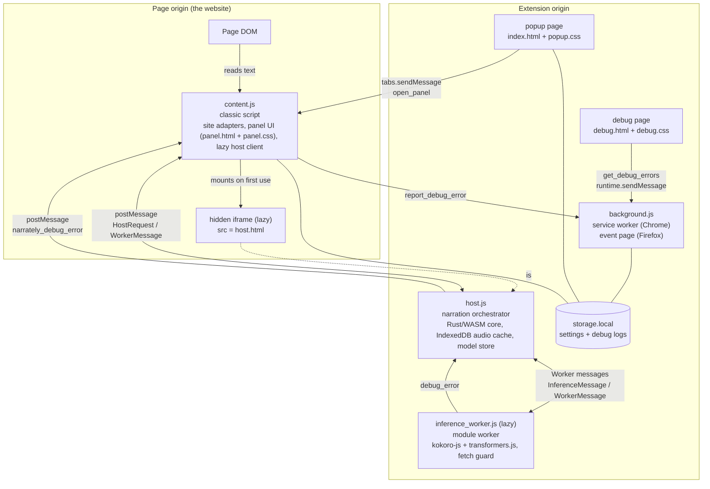
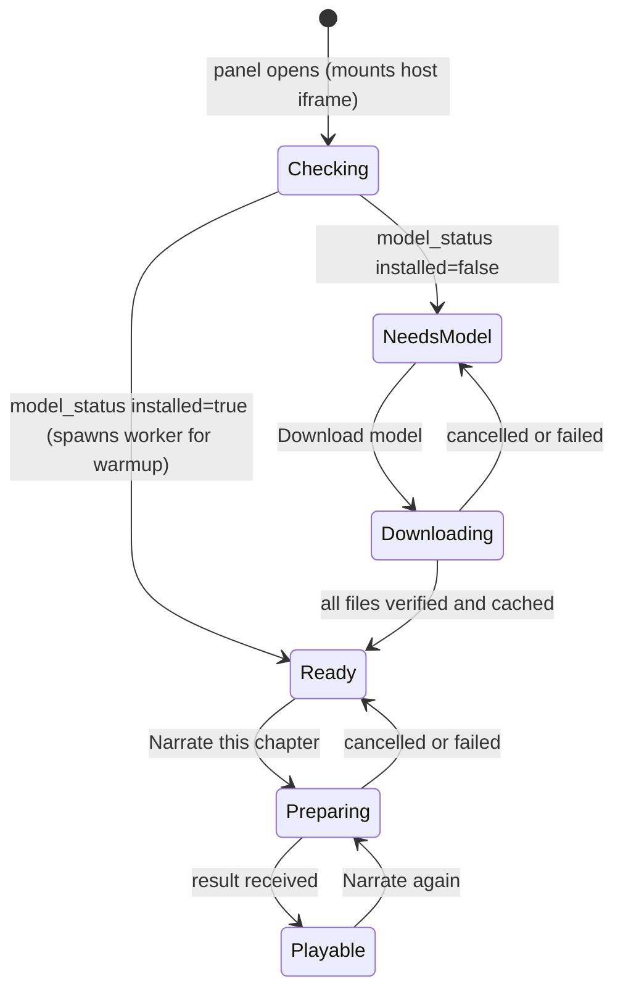

# Architecture

Narrately extracts chapter text in the page, generates speech on the device with
Kokoro-82M, and plays it back inside the page. The browser layer is TypeScript;
the deterministic domain core is Rust compiled to WebAssembly.

## Runtime contexts

Six extension contexts cooperate. Each exists because of a browser restriction
(see [Design notes](design-notes.md)).



| Context | Entry & UI Assets | Bundle format | Responsibilities |
| --- | --- | --- | --- |
| Content script | `src/content/index.ts`, `panel.ts`, `panel.html`, `panel.css` | IIFE (classic) | Detect chapters, render the Shadow DOM panel, drive playback, lazily embed the host iframe when the panel opens |
| Host page | `src/inference/host.html`, `host.ts` | ES module | Own the Rust/WASM core, the audio cache, and the model store; lazily spawn the inference worker for warmup/synthesis |
| Inference worker | `src/inference/worker.ts` | ES module worker | Load Kokoro, synthesize one chunk at a time, enforce the local-only fetch guard |
| Background | `src/background/index.ts` | IIFE (classic) | Seed default settings on install; handle settings, panel, and debug-log messages; retain up to 100 local diagnostic records |
| Popup | `src/popup/index.html`, `index.ts`, `popup.css` | ES module | Edit settings (reads and writes `storage.local` directly), manage storage, ask the active tab to open its panel |
| Debug page | `src/popup/debug.html`, `debug.ts`, `debug.css` | ES module | Display captured Narrately warnings/errors as a colour-coded list in a fixed-size window, and copy or clear the report |

The manifest declares both Chrome's and Firefox's background style in neutral
form; [`scripts/manifest.mjs`](../scripts/manifest.mjs) emits only the key each
browser accepts. See [Building and packaging](building.md).

## UI asset separation and shared controllers

Every UI view and icon lives in its own dedicated asset file:

- **In-page panel:** `src/content/panel.html` (template) and `src/content/panel.css` (Shadow DOM stylesheet), wired by `src/content/panel.ts`.
- **Toolbar popup:** `src/popup/index.html` and `src/popup/popup.css`, wired by `src/popup/index.ts`, `settings-view.ts`, and `storage-view.ts`.
- **Debug window:** `src/popup/debug.html` and `src/popup/debug.css` (extending base tokens from `popup.css`), wired by `src/popup/debug.ts`.
- **UI icons:** Dedicated SVG files under `src/icons/ui/` (`bubble.svg`, `close.svg`, `download.svg`, `forward15.svg`, `logo.svg`, `next.svg`, `pause.svg`, `play.svg`, `prev.svg`, `rewind15.svg`, `storage.svg`). `parseSvg()` in `src/shared/dom.ts` parses each SVG string once into a cached `SVGSVGElement` prototype and returns lightweight clones (`cloneNode(true)`).
- **Shared UI logic:** `src/shared/dom.ts` provides `getRequiredElement`, `parseSvg`, `populateVoiceSelect`, and `syncSpeedChips`; `src/shared/storageView.ts` provides `createStorageController`, shared by both the popup and the in-page panel.

## Narrating a chapter

```mermaid
sequenceDiagram
    actor User
    participant Panel as Panel (content.js)
    participant Host as Host page (host.js)
    participant Rust as Rust core (WASM)
    participant DB as IndexedDB audio_cache
    participant Worker as Inference worker

    User->>Panel: Narrate this chapter
    Panel->>Host: narrate {text, voiceId, speed, device, cacheEnabled}
    Host->>Rust: validate_synthesis_request
    Rust-->>Host: "" or error message
    Host->>Rust: chunk_text(text, 480)
    Rust-->>Host: chunks[] (zero-copy Cow slices -> JSON)
    Host->>Host: deduplicate identical chunks
    alt cacheEnabled
        Host->>Rust: cacheKeys(uniqueChunks, voice, speed)
        Host->>DB: readCacheMany(uniqueKeys) (single transaction)
    end
    loop each cache-miss unique chunk (2-chunk lookahead)
        Host->>Worker: synthesize {chunk, voice, speed, device}
        Worker-->>Host: WAV ArrayBuffer + duration
        opt cacheEnabled
            Host->>DB: put(key, audio) (shared IDBDatabase connection)
        end
        Host-->>Panel: progress {completed, total}
    end
    Host->>Host: merge WAV chunks (single-pass validation)
    Host-->>Panel: result {audio, durationMs} (ArrayBuffer transferred)
    Panel->>User: player ready (blob URL; raw ArrayBuffer released)
```

Details worth knowing:

- Cancellation is checked **between chunks**; a chunk that is already
  synthesizing finishes first.
- The worker serializes jobs through a promise chain, so only one chunk runs at a time, while a 2-chunk lookahead queue hides message round-trip latency.
- Identical chunks are deduplicated before WASM hashing and IndexedDB lookups; when `cacheEnabled` is false, hashing and IndexedDB access are skipped entirely.
- Download-to-file is a local `<a download>` click in the panel (file name
  `<book> - <chapter>.wav`) using the active `Blob` object URL. No `downloads` permission is used.

## Panel readiness



When the panel opens and the model is already installed, it is also pre-loaded
(`warmup`) so the first narration starts sooner. `device` (`wasm` or `webgpu`) selects which model files
are required; see [Model and voices](model-and-voices.md).

## Message contracts

All message types are declared in [`src/shared/messages.ts`](../src/shared/messages.ts).
Receivers validate `type` at runtime before narrowing.

| Channel | Direction | Types |
| --- | --- | --- |
| `runtime.sendMessage` | popup/content/debug page to background | settings and panel messages; `report_debug_error`, `get_debug_errors`, `clear_debug_errors` |
| `tabs.sendMessage` | popup to content | `open_panel` |
| `postMessage` | content to host iframe | `narrate`, `cancel`, `model_status`, `model_download`, `warmup`, `storage_info`, `clear_storage` |
| `postMessage` | host iframe to content | `progress`, `result`, `error`, `model_status`, `storage_info`, `narrately_debug_error` |
| `Worker.postMessage` | host to worker | `synthesize`, `cancel`, `warmup` |
| `Worker.postMessage` | worker to host | `progress`, `result`, `error`, `ready`, `debug_error` |

Every request carries a `jobId`. The content-side `HostClient` keeps a
`Map<jobId, listener>`; progress messages keep the listener, while `result`,
`model_status`, `storage_info`, and `error` settle and remove it.

## Data model

- `InferenceDevice` is `'wasm' | 'webgpu'`; `VoiceKind` is `'preset' | 'local_embedding'`.
- `Book.source` is a `SiteId`: the id of the adapter that produced the book (`'lnori'`, `'cyrisia'`, `'novelarchive'`, or `'generic'` for the best-effort fallback). Add a member per new site.
- Defaults: voice `af_heart`, speed `1`, device `wasm`, cache on.

## Chapter detection

Detection is a small plugin system. Each supported website has a **site adapter**
in `src/content/sites/`; `detectBook()` in `sites/index.ts` picks the first adapter
that recognizes the page and falls back to a generic one. The full guide for
adding a site is in [Adding a supported site](adding-a-site.md).

| Adapter | `Book.source` | Support level |
| --- | --- | --- |
| `lnori.ts` (`section.chapter` markup, host `lnori.com`) | `'lnori'` | **Official.** Multi-chapter books, real chapter titles, chapter navigation; untitled text selectors continue the prior chapter and image-only selectors are skipped |
| `cyrisia.ts` (`main.ch-page` and `#ch-text`, host `cyrisia.com`) | `'cyrisia'` | **Official.** Reads the chapter title and story from the live reader, with iframe fallback; sequential selectors for named chapter parts are joined |
| `novelarchive.ts` (`#reader-article`, host `novelarchive.cc`) | `'novelarchive'` | **Official.** One chapter per reader URL, with novel and chapter titles |
| `generic.ts` (scored article or main element) | `'generic'` | **Best effort.** One synthetic chapter named after the first heading; no chapter list; may pick the wrong block on unfamiliar layouts |

If nothing is found at load, `content/index.ts` watches DOM mutations (debounced
800 ms, up to 60 s) so reader sites that render late still get a panel.

## Storage

| What | Where | Owner |
| --- | --- | --- |
| Settings | `browser.storage.local` key `settings` | background, popup, panel |
| Captured Narrately logs | `browser.storage.local` key `debugErrors` (latest 100) | background, debug page |
| Generated audio | IndexedDB `narrately` / `audio_cache` (extension origin, shared across sites) | host page, popup |
| Model files | Cache API `narrately-model-v1` (extension origin) | host page, worker, popup |
| Voice packs | Bundled in the package under `models/.../voices/` | build |
