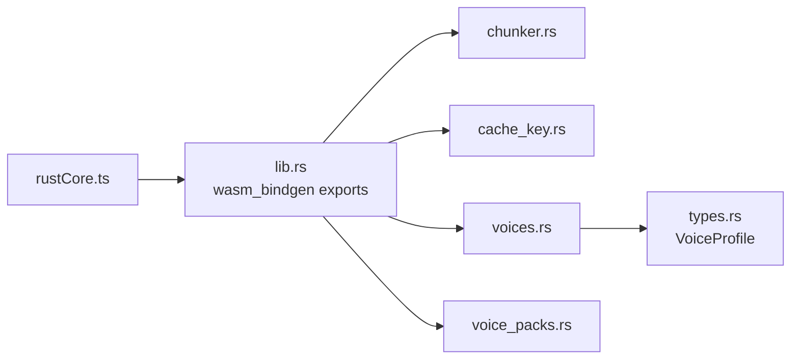
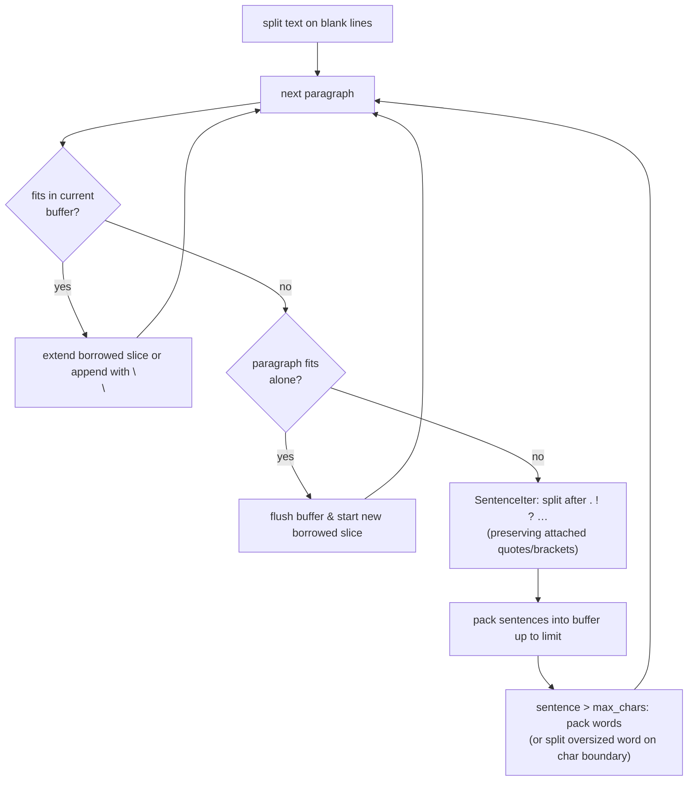

# Rust core

`crates/narrately-core` holds everything deterministic: text planning,
request validation, cache keys and voice metadata. It compiles to WebAssembly
via `wasm-pack` and is consumed only through
[`src/core/rustCore.ts`](../src/core/rustCore.ts).

## Modules



## Exported API

| Rust export | TypeScript wrapper | Returns |
| --- | --- | --- |
| `chunk_text(text, max_chars)` | `splitText(text, maxChars = 480)` | JSON array of strings |
| `validate_synthesis_request(text, voice_id, speed)` | `validateRequest(...)` | `""` when valid, otherwise an error message (the wrapper throws) |
| `build_cache_key(text, voice_id, speed)` | `cacheKey(...)` / `cacheKeys(...)` | `nr-<sha256 hex>` |
| `default_voice_catalog()` | `voiceCatalog()` | JSON array of voice profiles |
| `validate_voice_embedding(values)` | not wired yet | `""` or an error message |

Rust returns JSON strings and plain strings across the boundary; the TypeScript
side parses them, checks the shape at runtime before use, and caches WASM
initialization state so subsequent calls (`cacheKeys`, `splitText`,
`validateRequest`) execute without extra Promise microtask ticks.

### Validation rules

- Text must not be empty or whitespace.
- A voice is required and must be in the static `VOICE_SPECS` catalog (checked in O(N) without heap allocations).
- Speed must be within 0.5 to 2.0 (the popup and panel offer 1×, 1.25× and 1.5×).
- A voice embedding has exactly 256 finite values.

### Cache key

SHA-256 over `text`, `0x00`, `voice_id`, `0x00`, the speed as little-endian
`f32` bytes, prefixed with `nr-`. Changing any input yields a different key.
There is no model or device component, so clear the cache after changing models.

## Chunking

`chunk_slices` and `chunk_text` split narration into pieces of at most
`max_chars` bytes (minimum 64), keeping paragraphs together when they fit and
cutting at sentence ends (grouping consecutive terminal punctuation and closing
quotes/brackets), then words, and finally UTF-8 character boundaries only when
needed.



### Zero-copy `Cow<'_, str>` representation

`ChunkBuilder` tracks a `Cow<'a, str>` buffer over the input `source: &'a str`:

- When consecutive paragraphs, sentences, or words are already separated in `source` by the target delimiter (`"\n\n"` or `" "`), `ChunkBuilder::push` extends the borrowed `&'a str` slice in-place via pointer-offset range checks (`cur_end + sep.len() == piece_start`), performing **zero heap allocations and zero byte copies**.
- Only when non-canonical whitespace between pieces must be normalized does `ChunkBuilder` allocate a `String::with_capacity(max_chars)`.
- `lib.rs` serializes `chunker::chunk_slices(text, max_chars)` directly to JSON via `serde_json::to_string`, avoiding per-chunk `String` allocations across the WASM boundary.

## Working on the crate

```bash
cargo fmt --all
cargo clippy --workspace --all-targets --all-features -- -D warnings
cargo test --workspace
npm run build:wasm      # regenerate src/wasm/pkg
```

Rust follows `rustfmt` and `clippy`. The cross-language domain API uses the same
concepts and names on both sides: TypeScript keeps domain names in `snake_case`
at the core boundary, while UI-only DOM helpers stay `camelCase`. Comments
are short and explain intent, not syntax.

The generated files in `src/wasm/pkg/` (except `narrately_core.d.ts`) are
git-ignored; regenerate them with `npm run build:wasm`. `wasm-pack` also writes
a `.gitignore` containing `*` into that folder; `scripts/clean-wasm-pkg.mjs`
deletes it so the repository keeps a single root `.gitignore`.
